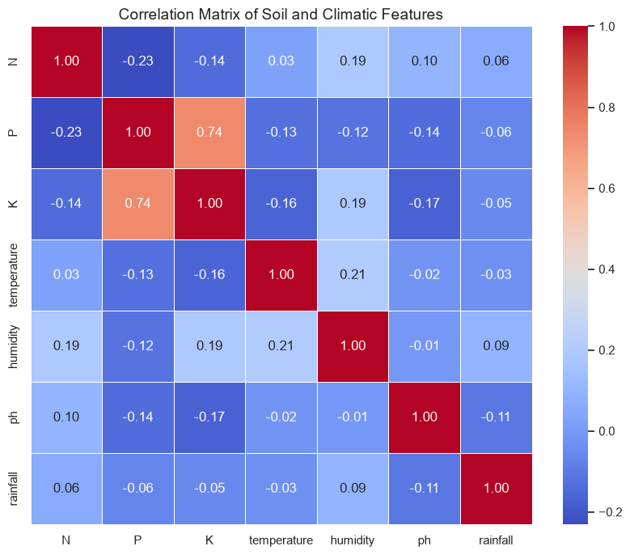

# AgriYield Predictor: Smart crop recommendation system

An end-to-end Machine Learning project designed to recommend the most suitable crop to grow in a specific soil and climatic environment. Using features such as soil nutrient levels (N, P, K) and environmental conditions (temperature, humidity, pH, and rainfall), this model achieves high-accuracy classification to optimize agricultural yield and decision-making.

---

## Project overview
In modern precision agriculture, data-driven decisions are crucial for maximizing productivity and resource efficiency. This project analyzes a comprehensive agricultural dataset to predict the best crop choice, helping farmers minimize risks and enhance sustainable practices.

## Features & dataset
The dataset consists of agricultural parameters:
* **N**: Ratio of Nitrogen content in soil
* **P**: Ratio of Phosphorous content in soil
* **K**: Ratio of Potassium content in soil
* **temperature**: Temperature in degrees Celsius (°C)
* **humidity**: Relative humidity in percentage (%)
* **ph**: pH value of the soil
* **rainfall**: Rainfall in millimeters (mm)
* **label**: Target crop category (e.g., rice, maize, coffee, cotton, etc.)

---

## 📈 Exploratory data analysis & insights
* **Correlation Matrix**: Analyzed the linear relationships between chemical soil properties. Notably, a strong positive correlation ($r = 0.74$) was found between **Phosphorous (P)** and **Potassium (K)** applications.
* **Feature Importance**: Using a Random Forest classifier, feature importance analysis revealed that **rainfall** and **humidity** play the most critical roles in determining the optimal crop choice, followed closely by soil nutrient profiles.

---

## Machine Learning model
* **Algorithm**: Random Forest Classifier
* **Performance**: Achieved an outstanding accuracy of **99%** on the test dataset.
* **Evaluation Metrics**: Precision, recall, and F1-score are consistently high across all individual crop classes.

---

## Code structure & usage

1. **Data Loading & Cleaning**:
   ```python
   import pandas as pd
   df = pd.read_csv('Crop_recommendation.csv')

### Data Analysis & Insights

**1. Correlation Matrix**


**2. Feature Importance**
